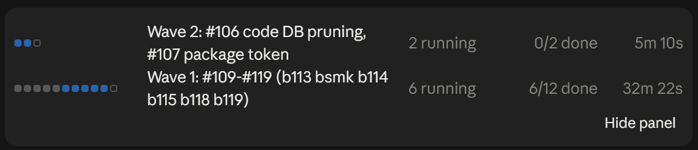
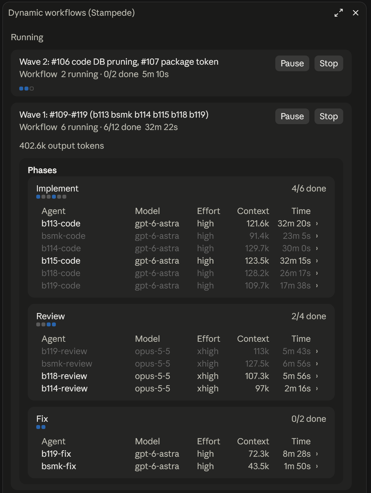

# Stampede

Stampede is a Claude Code plugin for running many AI workers at once from a single conversation. You (or Claude) write a short JavaScript workflow; Stampede runs it, starting Claude Code and Codex workers in parallel, in sequence, or as a team that messages each other, and hands the combined result back to your session.

- **Mix backends.** Each worker runs on Claude Code or Codex, with its own model, effort and role.
- **Safe by default.** Workers are read-only unless you allow edits; editing workers get their own Git worktree, so their changes land on a separate branch you review.
- **Deterministic and resumable.** Results are cached, so an interrupted or edited workflow resumes without redoing finished work.
- **Visible.** The `/stampede` pane shows each run, its phases, workers and messages, and wakes your session when a run finishes.

Everything runs locally through a small hub on your machine. Release candidate `1.0.0-rc.20`; see [V1_STATUS.md](docs/V1_STATUS.md).

## Install

You need Node 22+, Git, and Claude Code 2.1.292+ and/or Codex 0.159.2+, each already signed in. Stampede uses your existing CLI logins and never copies credentials.

There is no prebuilt release yet, so install from a checkout of this repository:

```powershell
npm ci
npm run build
node dist/cli.js init
node dist/cli.js doctor
claude plugin marketplace add C:\path\to\Stampede
claude plugin install stampede@stampede --scope user
```

`init` reads your Codex defaults, asks which shell commands Claude workers may run (it suggests your project's test command, such as `Bash(npm test)`; none unless you choose), and asks before writing Stampede's config; `doctor` checks that the backends and sandbox work. Then run `/reload-plugins` in an open Claude session, or start a new one.

## Use

Ask Claude in plain language, for example:

> Use Stampede to review this branch: have a Claude worker check the API changes and a Codex worker check the tests, then summarise the defects they agree on.

Claude writes a workflow like this and runs it:

```js
export const meta = { name: 'review', description: 'Review two areas independently' };
const [api, tests] = await parallel([
  () => agent('Review the API changes; return concrete defects only.', { name: 'api', backend: 'claude' }),
  () => agent('Review the tests for missed cases.', { name: 'tests', backend: 'codex' })
]);
return { api, tests };
```

The run starts in the background. While it runs, a band above the prompt shows a row per run, with a square per worker, its progress and its elapsed time:



Open `/stampede` to watch each run's phases and workers (model, effort, context used and time), read worker messages, or pause and stop a run; your session is woken with the result when it finishes (`/stampede wake off` turns that off).



Workflows can also be saved and reused, take `args`, form communicating teams, and resume after an interruption. The bundled `stampede-workflows` skill teaches Claude the full API.

Workers that edit files leave their changes on a Stampede branch. Inspect and merge those branches yourself.

## Maintenance

```powershell
node dist/cli.js hub --restart
node dist/cli.js gc
node dist/cli.js gc --worktrees
```

Restart the hub after updating the plugin; it refuses while a run is active (`--force` interrupts) and keeps running in the foreground unless given `--detach`. `gc` removes expired run artifacts; `gc --worktrees` asks first and never deletes uncommitted work or branches; from a session, `workflow_control` with `action: 'release'` removes the kept worktrees of the finished runs it names, and can delete their branches already merged.

State lives in `~/.stampede` (set `STAMPEDE_HOME` to move it), with settings in `config.json` there; a project's `.stampede/config.json` can only lower limits. The hub reads them when it starts, and `stampede doctor` shows the ones that stop long coding agents, with a warning for each: `claude.editShellAllow` (Claude edit agents, and read-only ones with `shell`, get no shell without it), `allowFullAccess`, `limits.turnTimeoutMs` (4 hours by default) and `codex.approvalsReviewer` (Codex workers ignore your own Codex config, so its automatic reviewer can refuse risky commands even under full access; `"user"` turns that off). Claude workers re-read their tool and skill lists on every API call, so they start without the tools listed in `claude.denyTools` (scheduling, remote triggers, notifications, design sync and worktree switching by default); `claude.skills: false` also drops skills and custom commands, which saves about a quarter of a worker's starting context but hides project skills. One `agent()` call can also choose its own worker: `tools` (Claude) narrows the built-in tools within its access level, `mcpServers` adds MCP servers from your own Claude Code or Codex config by name, or defined inline, and `plugins` (Claude) turns plugins on or off, such as `{ "*": false }` for none. `shell: true` lets a read-only Claude worker in a worktree run the `claude.editShellAllow` commands, to build and test; its worktree is thrown away at its end. `protect` names files a worker must not change, such as `["HANDOFF.md", "docs/**"]`: any change to them is put back on its branch when it ends. Workers otherwise load no MCP server but Stampede's. Workers can never start agents, teams or workflows of their own. Sandboxing limits what workers can do, but does not make untrusted workflow code or model output safe to run.
